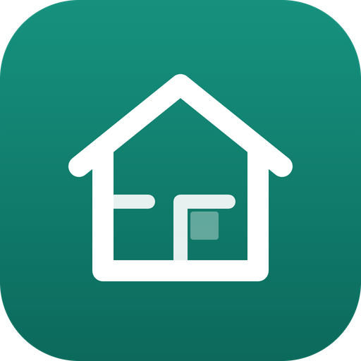

<p align="center">
  
</p>

<h1 align="center">Floorplan Studio</h1>

<p align="center">
  Desktop app for designing a house and the whole plot of land together.<br>
  Draw it in 2D, walk through it in 3D, and ask Claude for layout, furniture and landscaping ideas.
</p>

<p align="center">
  
  
  
  
</p>

---

## Features

- **Plan editor** – walls, rooms, doors, windows, furniture, ground surfaces (23 materials, 15 of them path and road surfaces such as asphalt, concrete, gravel, crushed stone, decomposed granite, cobblestone, granite setts, brick, flagstone, sandstone, pavers, terracotta and grass pavers, plus lawn, beds, hedges, decks and pools), plants, fences (large boundary fences and low white picket fences, each with an adjustable height) and **gates** (ten kinds, from pedestrian and double drive gates to sliding, cantilever and picket gates, which sit in a fence and cut an opening in it), with snapping to corners, walls and grid.
- **Backyard builder** – swimming, oval, kidney, plunge pools, a hot tub, a quincho (BBQ pavilion), a built-in parrilla, a soccer field and full or half basketball courts. Pick one in the Backyard drawer (P), set its width and depth, place it on the lot, then select it to resize or rotate it any time.
- **Select many, group and move** – drag a box on empty ground to select several things (left to right takes what is fully inside, right to left takes anything it touches), Shift-click or Ctrl-click to add or remove one, Ctrl+A for everything. Drag any selected part to move the lot, type an exact position, rotate 90° (`[` `]`), duplicate or delete them together. **Group** (Ctrl+G) keeps them together, saved with the design, so one click selects and moves the whole group; Ungroup is Ctrl+Shift+G. "Select whole house" on a room picks up its walls, doors, windows, furniture and plants.
- **Live area stats** – m² per room, usable and built totals, covered areas, lot coverage, lawn and surfaces by material. Room sizes are clear floor between wall faces.
- **Import a house** – bring a house you designed in another design onto this plot: tell Claude where it goes and which way it faces (or set the position and turn yourself), preview it, then apply.
- **Illustrated render** – a top-down render drawn to exact proportions (floors, lawn, pool, trees, furniture, shadows, dimension lines). Export as PNG or SVG.
- **3D view** – built from the plan. Each house gets its own roof. Orbit with the roof on or off, click to select, drag furniture across the floor and doors/windows along their wall.
- **First-person walk** – W A S D, mouse look, Shift to run, wall collision and walkable doorways. Mouse look uses raw input with spike filtering, and a **Mouse look speed** setting in the Walkthrough section tunes it. A Panini wide lens and upright-wall lens shift make rooms feel true to size.
- **House styles** – eight one-click styles (Modern, Mediterranean, Scandinavian, …) that set walls, roof, windows, doors, paint and floors.
- **Roofs, floors and paint** – six roof shapes, many roofing materials, 13 floor types and per-room wall paint.
- **Ask Claude** – describe a house in words, rebuild one from a photo of a floor plan, change a design in plain English, or furnish and landscape it. Every answer arrives as a suggestion to compare and apply or discard.
- **Autosave and undo** – designs save themselves as you work; up to 200 undo steps.
- **Light and dark themes**, or follow the system.

## Tech stack

| Layer | Technology |
| --- | --- |
| Desktop shell | Electron 33 (main process + sandboxed renderer) |
| 2D plan and render | SVG, generated in plain JavaScript |
| 3D view and walk | Three.js r158 (vendored in `src/vendor/`) |
| AI | Local [Claude Code](https://claude.com/claude-code) CLI, run as a child process |
| Packaging | electron-builder (Windows NSIS installer, macOS DMG) |

No front-end framework and no bundler: the renderer is a set of plain scripts sharing a `window.FP` namespace.

## Getting started

### Requirements

- Node.js 18+ and npm
- Optional, for the Claude features: [Claude Code](https://claude.com/claude-code) installed and signed in (`claude auth login`). Everything else works without it.

### Run from source

```bash
npm install
npm start
```

### Build installers

```bash
npm run dist:win   # Windows installer (NSIS, x64) in dist/ – also buildable from a Mac
npm run dist:mac   # macOS .dmg in dist/
```

The installer is not code-signed, so Windows SmartScreen may warn on first run (**More info → Run anyway**).

## Keyboard shortcuts

| Key | Action | Key | Action |
| --- | --- | --- | --- |
| V | Select | F | Furniture |
| W | Walls | A | Ground surfaces |
| R | Rooms | T | Plants |
| G | Fences | L | Laser measure |
| Z | Measure area | J | Gates |
| Ctrl+A | Select all | Ctrl+G | Group |
| Shift+Ctrl+G | Ungroup | Drag on empty ground | Box select |
| P | Backyard (pools, quinchos, courts) | | |
| D | Doors and openings | M | Measure |
| N | Windows | ⌘3 / ⌘4 | 3D view / Walk |
| Alt (hold) | Turn snapping off | Space (hold) | Pan |

## How the Claude integration works

The app runs the local `claude` CLI in print mode with tools disabled and a JSON schema for the answer. It never calls the API directly:

- Before each request it checks `claude auth status` and only proceeds on a Claude subscription login, never per-token API billing.
- API-key, custom-endpoint and cloud-provider environment variables are stripped from the CLI's environment, and Claude Code settings files are skipped.
- Claude only proposes geometry and placement. The app validates every number (sizes, clamps, ids, wall references) before showing a Current / Suggestion preview. Applying it is a single undo step.

## Project structure

```
main.js              Main process: windows, menus, file dialogs, designs folder, Claude CLI bridge
preload.js           The narrow API the page is allowed to call (contextBridge)
src/
  index.html         App shell
  app.js             State, undo/redo, autosave, files, export, theme, keyboard
  model.js           Project data, migrations, walls/rooms helpers, area stats
  geom.js            Plane geometry (area, point-in-polygon, projection, intervals)
  editor.js          Canvas interaction and tools
  draw.js            Plan and render drawing (SVG)
  panels.js          Toolbar, library, inspector, stats, layers, Claude dialogs
  claude.js          Prompts, JSON schemas, validation and suggestion diffs
  view3d.js          3D scene, materials, roofs, lighting, orbit/walk controls, picking
  post3d.js          Panini wide lens and upright-walls lens shift
  furniture3d.js     Procedural furniture and plant models
  catalog.js         Everything placeable: room kinds, materials, plants, furniture (real-world sizes)
  home.js            Home screen: new design three ways, or reopen a saved one
  sample.js          Starter project on a 30 × 40 m lot
  icons.js           Stroke icons (24×24, currentColor)
  vendor/three.min.js
build/               App icon
my-data/             Optional data bundled into installers (git-ignored)
```

See **[docs/ARCHITECTURE.md](docs/ARCHITECTURE.md)** for how the pieces fit together.

## Known limitations and roadmap

- No automated tests or CI yet – geometry (`geom.js`) and validation (`claude.js`) are the first candidates.
- Single storey only.
- Claude's furniture suggestions are clamped inside rooms but not checked for overlap.
- The 3D scene rebuilds fully on most edits; instancing and level-of-detail would help large plans.
- Hardening: validate paths and setting keys in the main process, and block new windows and navigation.

## Contributing

1. Create a branch from `main`.
2. Keep Node and file-system access in `main.js`; expose anything the page needs through `preload.js`.
3. Run `npm start` and check the plan, 3D and walk views before opening a pull request.
