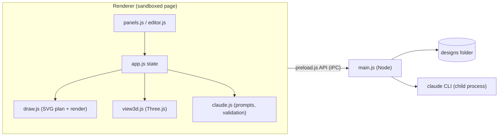

# Architecture

Floorplan Studio is an Electron app written in plain JavaScript. One project object is the single source
of truth: the 2D plan, the illustrated render, the 3D view and the area stats are all derived from it.



## 1. Two processes

| | Main process (`main.js`) | Renderer (`src/`) |
| --- | --- | --- |
| Runs | Node.js, full OS access | The UI, treated as untrusted |
| Does | Files, designs folder, settings, menus, runs `claude` | Editing, drawing, 3D, validation |

- The window is created with `contextIsolation: true`, `nodeIntegration: false` and `sandbox: true`, so page code cannot use Node or the file system.
- `preload.js` exposes a short list of named functions through `contextBridge`. That is the only way across.
- IPC styles:
  - `invoke` / `handle` (request and reply): `file:open`, `file:save`, `file:saveAs`, `file:exportPng`, `file:exportSvg`, `designs:list|load|save|delete`, `settings:get|set`, `claude:status|run|cancel`.
  - `send` / `on` (one-way notices): `app:dirty`, `app:title`, `app:theme`.
  - `prefs:bundled` is a single synchronous call when the preload starts.
- The Content Security Policy only allows scripts that ship with the app (`script-src 'self'`), which is why Three.js is vendored.
- Design ids must match `^[A-Za-z0-9_-]{1,64}$`, so an id cannot point outside the designs folder. Deleting a design moves it to the system Trash.

## 2. Data model (`src/model.js`)

- **Walls** are centre lines with a thickness: `{ id, x1, y1, x2, y2, t, kind }`, in metres.
- **Openings** (doors, windows) sit on a wall at a position along it, with width, height and sill height.
- **Rooms** are polygons (arrays of `{x, y}` on wall centre lines). Their clear size insets each edge by half its wall (`clearArea`).
- **Items** (furniture) and **plants** have a position, size and rotation. **Areas** are ground surfaces.
- `addWall` merges collinear stretches; `shiftLine` moves a whole straight run of wall; `classifyWall` tests points 0.3 m on each side to tell exterior from interior walls.
- `normalize()` repairs and migrates every loaded project, so older files open in newer versions.

## 3. State, undo and saving (`src/app.js`)

- One `state` object lives in a closure; `refresh()` redraws on the next animation frame.
- Undo stores JSON snapshots (limit 200). `beginChange()` / `endChange()` wrap a drag so it becomes one step.
- Autosave runs 1.2 s after the last change. Designs are written to a `.tmp` file and then renamed, so a crash cannot leave a half-written file.
- File formats: `.fpdesign` (`{ kind, version: 1, meta, project }`) in the app's designs folder, and `.fplan` for Save As.

## 4. Geometry (`src/geom.js`)

Small, pure functions in metres:

| Function | What it does | Used for |
| --- | --- | --- |
| `area` | Shoelace formula | Room and surface m² |
| `pointInPoly` | Ray casting (odd crossings = inside) | Hit testing, label placement |
| `labelPoint` | Centroid, or middle of the widest horizontal span if the centroid falls outside (L-shapes) | Room labels |
| `project` | Closest point on a segment, `t` clamped to 0–1, plus distance | Snapping to walls, walk collision |
| `simplify` | Drops repeated and collinear corners | Clean room outlines |
| `rotatedExtents` | Axis-aligned footprint of a rotated box | Keeping furniture inside rooms |
| `subtract` | Removes an interval from a list of intervals | Cutting door and window gaps from walls |

Snapping order in the editor: a corner within 10 px, then the nearest wall, then the grid. Alt turns snapping off; Shift frees the orthogonal lock.

## 5. 3D view (`src/view3d.js`, `src/post3d.js`, `src/furniture3d.js`)

- The scene is built from the same project data; nothing 3D is saved.
- Most edits rebuild the scene. Sliding an opening and dragging furniture only move that object. Materials and textures are cached until the detail level changes.
- Lighting: hemisphere sky light plus a directional sun with soft shadows (shadow map 1024 / 2048 / 4096 by detail level). The environment map is cached per time of day and detail level. ACES tone mapping at Medium and High.
- Furniture is procedural and merged per material, which reduces draw calls.
- `post3d.js` renders to a target and applies a Panini projection for wide angles, plus a lens shift that keeps walls vertical when looking up or down.

### Walk mode

- Pointer lock for mouse look; Shift runs at 2.2×.
- Eye height comes from a 1.72 m person, scaled by the **Size feel** setting.
- Collision: a step is blocked if it comes closer to a wall than half its thickness plus the body radius. X and Z are tried separately, so you slide along walls.
- Doorways are walkable when the sill is below 0.3 m and the opening is taller than 1.8 m.

## 6. Claude bridge (`main.js` + `src/claude.js`)

```
claude -p --output-format json --tools '' --no-session-persistence --strict-mcp-config \
       --setting-sources '' --system-prompt <prompt> --json-schema <schema> --model <model>
```

- The prompt is sent on stdin. Images (floor-plan photos) are sent as stream-json, resized to a maximum of 1800 px JPEG.
- The process is spawned without a shell. On Windows, a `claude.cmd` install is run through its `cli.js` with `ELECTRON_RUN_AS_NODE`. On macOS, `PATH` is read from the login shell.
- API-key, custom-endpoint and cloud-provider environment variables are removed, and `claude auth status` must report a subscription login before any request runs.
- Requests time out after 900 s and can be cancelled.

### Validating Claude's answer

`proposal()` in `src/claude.js` never trusts the model's numbers:

- Lot 5–500 m; walls at least 0.05 m long, 0.05–0.6 m thick.
- Openings at least 0.3 m wide, clamped to their wall, and dropped if the wall does not exist.
- Rooms need 3+ points and more than 0.1 m²; colours must be valid hex; duplicate ids are regenerated.
- Furniture is clamped inside its room with an 8 cm margin, sized 0.15–8 m, rotation snapped to 90°.
- The result goes through `normalize()`, is diffed by id against the current design and shown as Current / Suggestion. Apply is a single undo step.

## 7. Known gaps

- No automated tests, linting or CI.
- `file:save` accepts a path from the page, and `settings:set` accepts any key; both should be validated in the main process.
- No `setWindowOpenHandler` or `will-navigate` guard.
- No overlap check for suggested furniture; single storey only.
